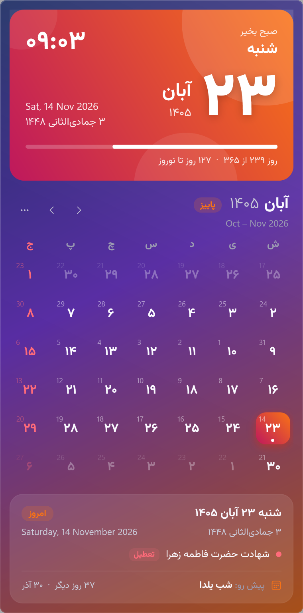
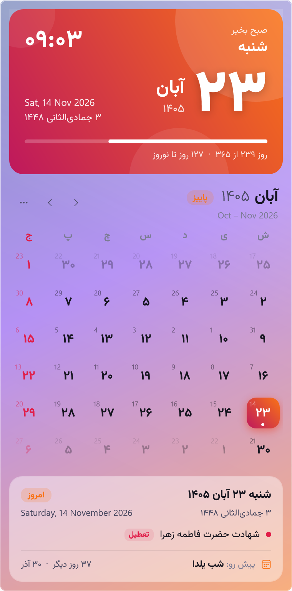
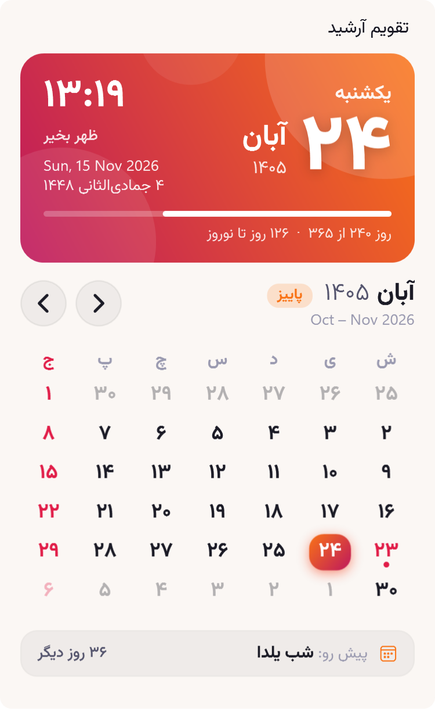

# تقویم آرشید · Arshid Calendar for Windows 11

A Persian (Solar Hijri / Jalali) calendar for Windows 11, built with **.NET 11** and **C# 14/preview**. It comes in two forms that share one calendar engine:

| | What it is | Where it lives |
|---|---|---|
| **Desktop widget** (`ArshidCalendar.Desktop`) | A frameless WPF window with a live clock, the full month and occasions. It uses the native Windows 11 acrylic backdrop | On your desktop: pinned under other windows, always on top, or a normal window |
| **Widgets Board provider** (`ArshidCalendar.WidgetProvider`) | An official Windows 11 widget in small, medium and large sizes, drawn in the same style and Vazirmatn font as the desktop widget | `Win + W` → **+** → «تقویم آرشید» |

<p align="center">
  
  &nbsp;
  
  &nbsp;
  
</p>

## Features

- **Today at a glance**: weekday, a large Persian day number, month and year, and a live clock (seconds optional). A greeting changes with the time of day (صبح/ظهر/عصر/شب بخیر).
- **Three calendars**: Solar Hijri, Gregorian and lunar Hijri. Each grid cell also shows the Gregorian day number in a corner.
- **Year progress**: a bar showing «روز ۲۳۶ از ۳۶۵ · ۱۳۰ روز تا نوروز».
- **Saturday-first month grid**: Fridays and official holidays in red, an event dot on days with occasions, and a glowing highlight on today. Clicking a faded day jumps to that month.
- **Occasions**: all official Iranian holidays (solar and lunar), plus Yalda, Chaharshanbe Suri, Mehregan, Tirgan, Sadeh and the days honouring Ferdowsi, Saadi, Hafez and others. The footer always shows the next upcoming occasion with a countdown.
- **Seasonal colours**: the hero card follows today's season (spring green, summer sun, autumn ember, winter ice). The accent colour follows the season of the month you're viewing, so the colours change as you browse.
- **Glass background**: a live blur of whatever is behind the widget, with a light tint, a soft shine and a highlighted edge. It stays glassy even when the widget isn't focused (the Windows 11 acrylic backdrop turns solid then). The «پس‌زمینهٔ شیشه‌ای» menu item switches to the denser frosted acrylic look.
- **Feels native on Windows 11**: acrylic backdrop, DWM rounded corners and shadow, light/dark that follows the system, Vazirmatn font, and Fluent icons.
- **Taskbar calendar flyout**: left-click the tray icon to get a Persian version of the Windows 11 clock calendar. It opens above the taskbar with the native acrylic, rounded corners and your Windows accent colour. It has a date header with a ⌄ button that folds the calendar away, a Saturday-first month grid with ▲ / ▼ carets (or the mouse wheel, `PgUp`/`PgDn`), and a year view when you click the month title. The footer shows the selected day in Gregorian and Hijri with its occasions, plus a «ویجت» button that opens the full desktop widget. Clicking elsewhere or `Esc` closes it, and it always reopens on today.
- **Tray icon** that always shows today's day number. Left-click opens the calendar flyout; right-click shows the widget and its menu.
- **Context menu** (right-click or the `⋯` button): pinned to desktop, always on top, or normal window; theme; show seconds; show Gregorian day numbers; start with Windows; hide; exit.
- **Widgets Board sizes**: small is a date tile; medium adds the current week; large has the full month with ‹ (previous) / › (next) buttons, a «امروز» button when you browse away, and the next occasion. The Widgets host only offers its system font, so the provider draws the card parts with WPF and Vazirmatn and sends them as images. Each part comes in a dark and a light version, chosen with `$host.hostTheme`.
- **Keyboard and mouse**: `←`/`→` (previous / next) or `PgUp`/`PgDn` change month, `↑`/`↓` change year, `Home`/`T` go to today, `Esc` hides the widget. Mouse wheel changes month; Ctrl+wheel changes year. Drag the hero card to move the widget; its position is remembered.

## Requirements

- Windows 11 (22H2 or later recommended)
- [.NET 11 SDK](https://dotnet.microsoft.com/download/dotnet/11.0). `global.json` pins `11.0.100` with `rollForward: latestFeature`.
- For the Widgets Board provider:
  - **Developer Mode** (Settings → System → For developers)
  - **Windows App Runtime 2.6**. It is usually installed already; otherwise run `winget install Microsoft.WindowsAppRuntime.2.6`.

## Getting started

```powershell
# Build everything and run the tests
dotnet build ArshidCalendar.slnx
dotnet test  tests/ArshidCalendar.Core.Tests

# Desktop widget
dotnet run --project src/ArshidCalendar.Desktop

# MSIX package: desktop widget + Widgets Board provider (registers it for the current user)
./scripts/Install-WidgetProvider.ps1          # then: Win+W → + → «تقویم آرشید»
./scripts/Uninstall-WidgetProvider.ps1
```

In **Visual Studio 2026**, open `ArshidCalendar.slnx`. Set `ArshidCalendar.WidgetProvider` as the startup project and press F5 to deploy and debug the widget.

## Versioning and package identity

The software version is set in **one place**, `AppVersion` in [`Directory.Build.props`](Directory.Build.props):

```xml
<AppVersion>1.0.0.0</AppVersion>   <!-- Major.Minor.Build.Revision, each part 0–65535 -->
```

The following all come from it, so nothing else needs editing:

- `ApplicationVersion`, `AssemblyVersion`, `FileVersion` and `Version` for every project
- the exe's file properties
- the version shown at the bottom of the desktop widget's menu
- the MSIX `Identity Version` in `Package.appxmanifest`, which is updated automatically at build time

The MSIX identity is set next to it, and is also written into `Package.appxmanifest` at build time:

```xml
<PackageIdentityName>ArshidCalendar</PackageIdentityName>                     <!-- Package/Identity/Name -->
<PackagePublisher>CN=ArshidCalendar</PackagePublisher>                       <!-- Package/Identity/Publisher -->
<PackagePublisherDisplayName>Arshid Calendar</PackagePublisherDisplayName>   <!-- Package/Properties/PublisherDisplayName -->
```

> The Microsoft Store reserves the last part (Revision): it must be `0` in Store packages (`Publish.ps1 -Store` checks this). Raise `Build`, `Minor` or `Major` for each update.

## The MSIX package

One MSIX holds **both apps**. `ArshidCalendar.WidgetProvider` is the packaging project, and it brings in the desktop exe through a project reference:

| Application | Exe | What it does |
|---|---|---|
| `Desktop` | `ArshidCalendar.exe` | Desktop widget and tray calendar. It appears in Start, and it's what the Store's "Launch" button opens. «اجرا همراه با ویندوز» uses the package's `StartupTask` (you can also manage it in Settings → Apps → Startup). |
| `App` | `ArshidCalendar.WidgetProvider.exe` | Widgets Board provider. A COM server the Widgets host starts on demand; it has no Start entry. |

Both exes are self-contained and share a single .NET runtime in the package root. The Store installs the Windows App Runtime dependency automatically.

## Publishing to the Microsoft Store

1. **Reserve the name** in [Partner Center](https://partner.microsoft.com/dashboard) → Apps and games → New product → MSIX or PWA app. Reserve «تقویم آرشید» and/or *Arshid Calendar*.
2. **Copy the identity.** Open Product management → Product identity, and copy `Package/Identity/Name`, `Package/Identity/Publisher` and `Package/Properties/PublisherDisplayName` into `PackageIdentityName`, `PackagePublisher` and `PackagePublisherDisplayName` in `Directory.Build.props`.
3. **Build the upload package:**
   ```powershell
   ./scripts/Publish.ps1 -Store      # → artifacts/<version>/Store/ArshidCalendar_<version>.msixbundle (x64 + ARM64, unsigned)
   ```
   The Store signs the package itself, so no certificate is needed.
4. **Optional: test it locally** with the Windows App Certification Kit (`appcertui.exe`, from the Windows SDK) against the `.msixbundle`.
5. **Create the submission:**
   - *Packages*: upload the `.msixbundle`.
   - *Properties*: category **Productivity**. The app collects no personal data and makes no network calls; a privacy policy URL is still recommended.
   - *Restricted capabilities*: Partner Center asks why the package uses `runFullTrust`. Answer: *"Desktop (WPF) application and Windows 11 Widgets Board provider (out-of-process COM server); full trust is required for Win32 desktop apps."*
   - *Store listing* (Persian, fa-IR, which is the package language): description, at least one screenshot (1366×768 or larger; `ArshidCalendar.exe --snapshot out.png [--dark|--light]` and the `--preview` images help), and a 300×300 store logo.
   - *Pricing and availability*: choose markets.
   - *Age rating*: fill in the IARC questionnaire (the app has no user content or network features).

## Direct distribution (outside the Store)

```powershell
./scripts/Publish.ps1                      # self-contained (no .NET install needed)
./scripts/Publish.ps1 -FrameworkDependent  # small desktop exe; users need the .NET 11 Desktop Runtime
./scripts/Publish.ps1 -CertificatePath my.pfx -CertificatePassword (Read-Host -AsSecureString)
```

Output in `artifacts/<version>/`:

| File | For users |
|---|---|
| `ArshidCalendar-<version>-win-x64.zip` | Desktop widget only. Unzip and run `ArshidCalendar.exe`. It's one self-contained file; the first start unpacks it to `%TEMP%\.net`. |
| `ArshidCalendar-Msix-<version>-x64.zip` | Desktop widget + Widgets Board widget. Unzip, then run `Install.ps1` as administrator. It trusts the signing certificate and installs the signed `.msix`. |

A sideloaded MSIX must be signed with a certificate whose subject equals `PackagePublisher`. Without `-CertificatePath`, the script creates a self-signed one once in `Cert:\CurrentUser\My` and reuses it.

> Development installs (`Install-WidgetProvider.ps1`) stamp a time-based package version so they can update in place. Before installing a published or Store MSIX on the same machine, remove the development install with `./scripts/Uninstall-WidgetProvider.ps1`. Otherwise Windows treats the published package as a downgrade.

## Solution layout

```
ArshidCalendar.slnx          ← XML solution format (.slnx)
Directory.Build.props               ← shared settings: LangVersion=preview, nullable, analyzers
Directory.Packages.props            ← Central Package Management
global.json
src/
  ArshidCalendar.Core/             ← UI-agnostic calendar engine (+ shared season colours)
    JalaliDate.cs                   ← readonly record struct over DateOnly
    HijriDate.cs                    ← Umm al-Qura + Iran adjustment
    EventCatalog.cs                 ← holidays and occasions (FrozenDictionary)
    MonthLayout.cs                  ← Saturday-first month grid
    Extensions.cs                   ← C# 14 extension members
  ArshidCalendar.Desktop/          ← WPF desktop widget
    MainWindow.xaml                 ← hero card, navigation, grid, details
    ViewModels/                     ← MVVM with C# 14 `field`-backed properties
    Services/                       ← DWM backdrop, theme, tray, settings, startup
    Themes/                         ← Dark / Light palettes + control styles
  ArshidCalendar.WidgetProvider/   ← Widgets Board provider (COM server) + the MSIX packaging project
    WidgetProvider.cs               ← IWidgetProvider implementation
    CardData.cs                     ← Adaptive Card data binding
    Rendering/CardRenderer.cs       ← WPF + Vazirmatn drawing of the card parts (STA render thread)
    Templates/                      ← small / medium / large Adaptive Card templates
    Com/ClassFactory.cs             ← [GeneratedComInterface] class factory
tests/ArshidCalendar.Core.Tests/   ← MSTest 4
tools/generate-assets.cs            ← file-based app: regenerates icons and images
scripts/                            ← install / uninstall the dev package, Publish.ps1 (-Store)
```

## Modern .NET and C# features used

| Feature | Where |
|---|---|
| **Extension members** (`extension(T x) { … }`, C# 14) | `Core/Extensions.cs`: `DayOfWeek.PersianIndex`, `int.ToPersianDigits()`, `JalaliDate.MonthName` |
| **`field` keyword** (C# 14) | Every view-model property: `{ get; set => SetProperty(ref field, value); }` |
| **Null-conditional assignment** `a?.B = x` (C# 14) | `MainViewModel.Select`, `App.ToggleSeconds`, `WidgetProvider.Deactivate` |
| **`System.Threading.Lock`** (C# 13) | Thread-safe widget state in `WidgetProvider` |
| Collection expressions and spreads, list patterns | Throughout; `args is ["--snapshot", var path, ..]` |
| Primary constructors | `EventCatalog`, `DayCellViewModel`, `RelayCommand` |
| `TimeProvider` | Clock abstraction in the view model and the widget provider |
| `FrozenDictionary` | Holiday lookups |
| `[LibraryImport]` source-generated P/Invoke | `NativeMethods`, `Ole32` |
| `[GeneratedComInterface]` / `[GeneratedComClass]` | COM class factory for the widget host |
| `System.Text.Json` source generation | `SettingsJsonContext` |
| File-based apps (`dotnet run file.cs`, `#:package`) | `tools/*.cs` |
| `.slnx` + Central Package Management | Solution root |

## Customising

- **Holidays and occasions**: edit the `Solar` and `Lunar` tables in `src/ArshidCalendar.Core/EventCatalog.cs`.
- **Lunar date adjustment**: lunar dates use the Umm al-Qura calendar shifted by `HijriDate.IranAdjustment` (−1 day), which matches Iran's official calendar for the tested dates. You can override it per user with `HijriAdjustment` in `%LOCALAPPDATA%\ArshidCalendar\settings.json`. Lunar holidays may still differ by a day from the final official announcement.
- **Season colours**: `ThemeService.SeasonColors` (desktop) and `tools/generate-assets.cs` (widget backgrounds).
- **Screenshots and docs**: `ArshidCalendar.exe --snapshot out.png [--dark|--light]` renders the widget to a PNG.
- **Inspecting the widget cards**: `ArshidCalendar.WidgetProvider.exe --preview <folder>` renders every card part and a Widgets Board mock-up for each size and theme (`large-dark.png`, …), plus the data JSON. Picker screenshots in `Assets/Screenshot*.png` come from this.

## Credits

- Font: [Vazirmatn](https://github.com/rastikerdar/vazirmatn) by Saber Rastikerdar, SIL Open Font License 1.1
- Icons: Segoe Fluent Icons (Windows)
